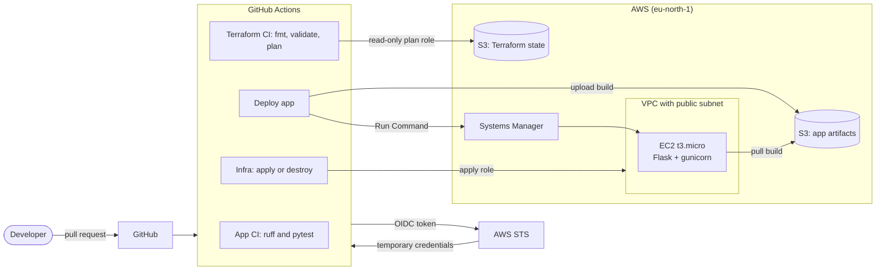

# AWS CI/CD Foundations

A small, end-to-end CI/CD pipeline on AWS, built as a hands-on learning project. A Flask app is tested on every pull request, its infrastructure is planned and applied with Terraform from GitHub Actions, and the app is deployed to an EC2 instance through AWS Systems Manager. No SSH, no open admin ports and no long-lived AWS credentials anywhere.

**Stack:** GitHub Actions, Terraform, EC2, S3, IAM (OIDC), Systems Manager, Python/Flask

## Architecture



## Repo layout

```
.
├── .github/workflows/
│   ├── ci.yml             # App lint and tests on PRs and pushes to main
│   ├── terraform-ci.yml   # fmt, validate and plan on PRs, plan posted as a comment
│   ├── infra.yml          # Manual apply or destroy of the infra layer
│   └── deploy.yml         # Package, upload, deploy via SSM, health check
├── app/                   # Flask hello-world app and tests
├── deploy/
│   └── remote-deploy.sh   # Runs on the instance: install, systemd service, health check
├── bootstrap/             # Persistent layer, applied once by hand
│   └── main.tf            # OIDC provider, plan and apply roles, artifacts bucket
├── infra/                 # Disposable layer, applied by the pipeline
│   ├── main.tf            # VPC, subnet, security group, IAM instance role, EC2
│   └── outputs.tf
└── CLAUDE.md              # Project context for Claude Code
```

## How it works

| Workflow | Trigger | What it does | AWS role |
|---|---|---|---|
| **CI** | Pull request, push to `main` | Lints with ruff, tests with pytest | none |
| **Terraform CI** | Pull request | `fmt -check`, `validate`, `plan`, then comments the plan on the PR | plan (read-only) |
| **Infra** | Manual (apply or destroy). Optionally on merge | Runs `terraform apply` or `destroy` on `infra/` | apply |
| **Deploy app** | Manual | Uploads a build to S3, runs the deploy script on the instance through SSM, checks `/health` | apply |